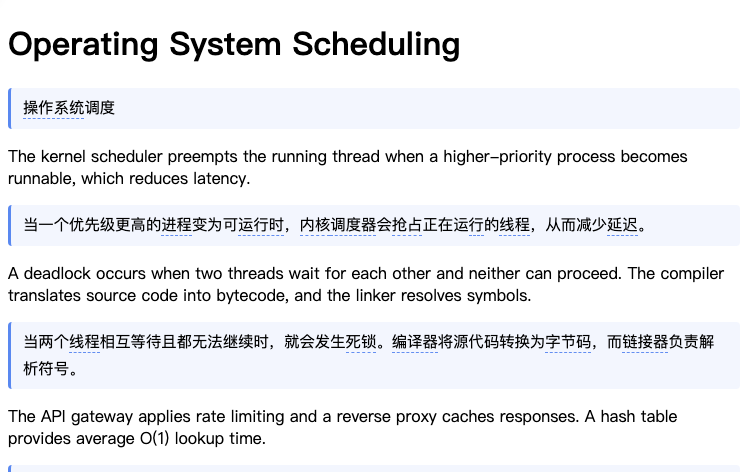
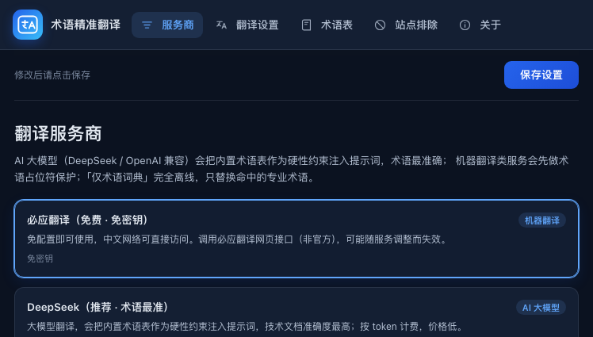
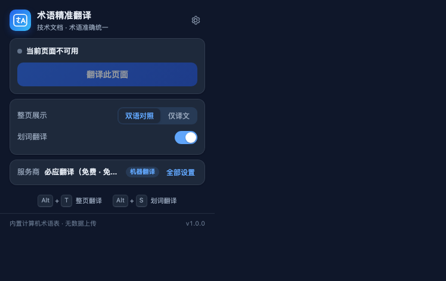

# 术语精准翻译 · Tech Terms Translator

> 一款为 Microsoft Edge 打造的技术文档翻译扩展：内置 790+ 条计算机术语（22 个分类），让 thread 始终翻译成「线程」，而不是「帖子」。
>
> Manifest V3 · 中文界面 · 零第三方依赖 · 无需构建 · 可在 edge://extensions 直接加载

## 目录

- [项目简介](#项目简介)
- [功能特性](#功能特性)
- [界面预览](#界面预览)
- [安装步骤](#安装步骤)
- [快速开始](#快速开始)
- [服务商对照表](#服务商对照表)
- [使用说明](#使用说明)
- [术语表机制](#术语表机制)
- [常见问题](#常见问题)
- [隐私声明](#隐私声明)
- [项目结构](#项目结构)
- [开发与测试](#开发与测试)
- [发布到 Microsoft Edge 加载项商店](#发布到-microsoft-edge-加载项商店)
- [已知限制](#已知限制)
- [许可证](#许可证)

## 项目简介

读英文技术文档时，机器翻译最让人抓狂的不是句子不通，而是**术语翻错**：thread 被翻成「帖子」、process 被翻成「过程」、deadlock 被翻成「僵局」、race condition 被翻成「种族条件」。这类错误一旦出现在关键段落，理解成本比直接读原文还高。

本扩展针对这个问题做了两件事：

1. **内置 790+ 条计算机术语表（22 个分类）**，覆盖操作系统、体系结构、数据结构与算法、编程语言、数据库、网络、安全、软件工程、版本控制、测试、编译原理，以及前端、浏览器、后端、云原生/DevOps、AI/机器学习、大数据、构建工具等方向，每条都给出大陆 IT 行业通用译名。
2. **术语保护**：使用机器翻译服务商时，先把命中的术语替换成不会被翻译的占位符，翻译完成后再强制还原成术语表中的中文译名；使用大模型服务商时，则把术语表作为硬性约束注入提示词。两种方式都能保证同一术语在整篇文档里译法一致。

在上述基础上，扩展提供**划词翻译**和**整页双语对照翻译**两种日常用法，并支持仅显示译文、术语高亮、自定义术语、排除站点等实用选项。

## 功能特性

- **术语精准**：790+ 条内置计算机术语，中英双向可查（中文界面展示英文术语 + 推荐译名 + 易错点说明）。
- **术语占位符保护**：机器翻译不会再把 thread 翻成「帖子」，术语译名逐字还原。
- **大模型术语约束**：DeepSeek / OpenAI 兼容服务商会把命中的术语表注入提示词，长文翻译术语统一。
- **划词翻译**：选中文本后点击悬浮「译」按钮（或自动触发），就地显示译文卡片，支持复制、朗读源文。
- **整页双语对照**：在原文段落下方插入译文，中文在上（或英文在上，随站点结构），可随时一键还原。
- **仅译文模式**：隐藏原文只显示中文，适合快速通读；可切回双语模式。
- **术语高亮**：整页翻译时高亮命中的专业术语，鼠标悬停查看译名与易错点说明。
- **自定义术语表**：支持增删改自己的术语（例如团队内部黑话、产品名），自定义优先于内置术语。
- **排除站点**：把不需要翻译的域名加入排除列表，扩展在这些站点自动静默。
- **翻译缓存**：重复文本命中本地缓存，省钱、省时间，可一键清空。
- **7 种翻译服务商**：默认必应免费接口，免配置即可使用；也支持 DeepSeek、Azure、OpenAI 兼容接口、MyMemory、离线术语词典、Google 翻译。
- **中文界面、零依赖、无构建**：源码即产物，无第三方依赖，不加载任何 CDN / 远程字体 / 远程图片。
- **隐私友好**：不收集任何数据，设置与密钥只存在本地，待翻译文本只发送给用户主动选择的服务商。

## 界面预览

整页双语对照翻译（原文段落下方插入译文、专业术语高亮、行内代码用占位符保护不被误翻）：



设置页（服务商 / 翻译 / 术语表 / 排除站点 / 关于）：



工具栏弹窗（当前页面翻译状态、双语 / 仅译文切换、划词翻译开关、快捷键提示）：



> 以上截图来自项目自带的 headless Edge 真机冒烟测试（真实必应翻译 + 本地技术文档测试页），非设计稿。

## 安装步骤

### 从源码 / 压缩包安装（开发者模式）

1. 获取项目文件：
   - 源码方式：`git clone` 本仓库，或直接解压源码压缩包；
   - 发布包方式：解压 `edge-terms-translator-v1.0.0.zip`（压缩包根目录应能看到 `manifest.json`）。
2. 打开 Edge，在地址栏输入 `edge://extensions` 并回车。
3. 打开左侧（或页面右下角）的 **开发者模式** 开关。
4. 点击 **加载解压缩的扩展**，选择包含 `manifest.json` 的项目根目录。
5. 加载成功后，在扩展卡片上点击 **详细信息**，确认没有报错；点击工具栏的拼图图标，把「术语精准翻译」**固定到工具栏**。
6. 随意打开一个英文技术文档页面，选中一段文字，看到「译」按钮即安装成功。

> 系统要求：Microsoft Edge 109 及以上（基于 Chromium 的 Chrome / Brave / Vivaldi 等浏览器同样可加载，但本项目只针对 Edge 做适配与验收）。

### 从 Microsoft Edge 加载项商店安装

商店上架后，可在 [Microsoft Edge 加载项](https://microsoftedge.microsoft.com/addons) 搜索「术语精准翻译」安装。上架状态以商店页面为准。

## 快速开始

1. **安装完成后无需任何配置**：默认使用「必应翻译（免费 · 免密钥）」，直接划词或翻译整页即可。
2. **推荐配置 DeepSeek 获得最佳术语准确度**：
   - 打开扩展设置页（工具栏图标 -> 设置，或 `edge://extensions` 中点击「扩展选项」）。
   - 在「服务商」中选择 **DeepSeek（推荐 · 术语最准）**。
   - 填入 API Key（在 [platform.deepseek.com](https://platform.deepseek.com/api_keys) 创建）、接口地址（默认 `https://api.deepseek.com/v1`）、模型名称（默认 `deepseek-chat`）。
   - 点击 **测试连接**，看到「连接成功」后保存。
3. 打开英文技术文档页面：
   - 选中文字 -> 点击「译」按钮 = 划词翻译；
   - 点击工具栏图标 -> **翻译整页**（或按 `Alt+T`）= 整页双语对照；
   - 再按一次 `Alt+T`（或点击「还原原文」）= 恢复页面。
4. 对翻译结果不满意？可在设置里切换服务商、调整目标语言、关闭/开启术语强制约束，或添加自定义术语。

## 服务商对照表

扩展内置 7 种服务商，可在设置页随时切换。默认服务商为「必应翻译（免费 · 免密钥）」。

| 服务商 | 需要密钥 | 免费额度 | 获取方式 | 适用场景 |
| --- | --- | --- | --- | --- |
| **必应翻译（免费）** | 否 | 免费，无官方额度承诺（调用必应网页接口，非官方 API） | 无需配置，安装即用 | 日常浏览、快速翻译、不便申请密钥时；接口可能随必应页面调整而失效 |
| **DeepSeek**（推荐） | 是 | 按 token 计费，价格低；新账号以官方活动为准 | [platform.deepseek.com/api_keys](https://platform.deepseek.com/api_keys) 创建 API Key | 技术文档、长文、术语要求高的场景；大模型 + 术语表约束，准确度最高 |
| **Azure AI 翻译** | 是 | 每月 200 万字符免费额度（F0 层，以 Azure 官方为准） | Azure 门户创建「Translator」资源，获取订阅密钥与区域 | 企业 / 长期稳定使用；微软官方接口，术语和格式稳定 |
| **OpenAI 兼容接口** | 是（本地模型可留空） | 取决于所选服务 | 填任意兼容 OpenAI Chat Completions 的 `baseUrl` + `model` + `apiKey` | 已有硅基流动 / Kimi / 智谱 / Ollama / LM Studio 等服务时复用 |
| **MyMemory** | 否 | 匿名每日有限额度；填联系邮箱可提高额度（以官方说明为准） | 无需配置；可选填邮箱 | 兜底备用；质量一般，适合短句 |
| **仅术语词典（离线）** | 否 | 离线、无限制、不联网 | 无需配置 | 只看关键词含义、快速扫读；不翻译句子，其余内容保留英文 |
| **Google 翻译** | 否 | 免费，无官方额度承诺 | 无需配置，但需要网络可访问 Google | 海外网络环境；中国大陆网络通常无法访问 |

> 所有密钥仅保存在浏览器本地 `chrome.storage.local`，不会上传到任何第三方服务器；测试连接按钮会直接用你填入的密钥请求对应服务商。

## 使用说明

### 划词翻译

- 在任意网页选中英文（或中文）文本，页面出现悬浮「译」按钮，点击即可就地显示译文卡片。
- 在设置 -> 翻译 中可把触发方式改为「选中后自动翻译」（不需要点击按钮）。
- 译文卡片支持**复制译文**、**朗读原文**、**关闭**；部分页面会显示术语命中提示。
- 单次划词长度上限为 5000 字符，超长请使用整页翻译。

### 整页双语对照

- 点击工具栏图标，在弹窗中点击 **翻译整页**；或直接按快捷键 `Alt+T`。
- 默认「双语对照」模式：在每段原文下方插入译文，原文保留，方便对照阅读。
- 在弹窗或设置中切换为 **仅显示译文** 模式：隐藏原文只显示中文，适合快速通读。
- 翻译完成后可点击 **还原原文** 恢复页面初始状态；页面结构变化（如单页应用切换路由）后需要重新翻译。
- 翻译是分片进行的，进度会显示在页面右下角的状态条 / 弹窗中；长页面请耐心等待。

### 快捷键

| 快捷键 | 功能 | 修改方式 |
| --- | --- | --- |
| `Alt+T` | 翻译 / 还原当前页面 | `edge://extensions/shortcuts` |
| `Alt+S` | 翻译当前选中的文字 | `edge://extensions/shortcuts` |

> 快捷键可能与其他扩展冲突。若按下无反应，请到 `edge://extensions/shortcuts` 检查并重新分配。

### 右键菜单

- 选中文字后点击右键，选择 **翻译选中文本**。
- 在页面空白处点击右键，选择 **翻译整页** / **还原原文**。
- 右键菜单项由后台 Service Worker 注册，安装/更新扩展后自动生效。

## 术语表机制

### 数据来源与结构

术语数据位于 `src/data/` 目录，拆成两份便于维护：

- `glossary-core.js` -> `CORE_GLOSSARY`：计算机基础术语（操作系统、体系结构、数据结构与算法、编程语言、数据库、网络、安全、软件工程、版本控制、测试与质量、编译原理、通用 IT）。
- `glossary-web.js` -> `WEB_GLOSSARY`：Web 与应用层术语（前端、浏览器、后端、云原生/DevOps、AI/机器学习、大数据、构建工具、移动开发、图形与游戏等）。

每条术语的结构（详见 `src/lib/glossary.js` 顶部注释）：

| 字段 | 类型 | 说明 |
| --- | --- | --- |
| `en` | string | 英文术语规范形式，唯一（不区分大小写去重） |
| `zh` | string | 推荐简体中文译名，术语保护时强制还原为该译名 |
| `category` | string | 分类，用于术语表展示与筛选 |
| `pos` | string | 词性：`noun` / `verb` / `adj` / `adv` / `phrase` / `abbr` / `other` |
| `note` | string | 可选，易错点 / 释义补充，显示在术语提示中 |
| `aliases` | string[] | 可选，别名 / 缩写 / 常见变体（如 `k8s`、`JS`） |
| `noEnforce` | boolean | 可选，true 表示该词歧义大、不参与强制术语保护 |

两份数据按 `en` 规范化去重后合并，`CORE_GLOSSARY` 优先；运行时再合并用户自定义术语，自定义条目覆盖同名内置条目。

### 自定义术语

设置页 -> **术语表** 标签中可以：

- 搜索内置术语（支持英文、中文、别名、备注）；
- 新增自定义术语（英文 + 中文，可选备注），例如公司产品名、内部缩写；
- 删除自定义术语；自定义术语与内置术语同名时优先生效。

### 术语保护原理（占位符）

机器翻译服务商（必应、Azure、MyMemory、Google）不理解「术语表」概念，于是扩展采用**占位符保护**：

1. 用术语表匹配待翻译文本，找出所有命中的术语（长词优先、大小写不敏感、识别常见复数形式）。
2. 把命中的术语替换成机器翻译不会改写的占位符，例如 `⟦1⟧` 这样的标记；映射关系保存在内存中。
3. 把「占位符化」的文本发送给服务商翻译，其余内容获得正常机器翻译质量。
4. 收到译文后，把占位符逐个还原为术语表中的中文译名。

这样机器翻译只负责普通句子，专业术语的译名始终由术语表决定。对于明确存在歧义、通常不应强改的词（如 `thread` 在论坛语境下也可能是「帖子」），术语数据中标记了 `noEnforce` 的词不会被强制替换，避免误伤。

大模型服务商（DeepSeek、OpenAI 兼容）则采用另一种方式：把命中的术语表（英文 -> 中文）作为硬性约束写进提示词，要求模型必须使用指定译名，同时在返回后做一次术语一致性检查，必要时纠正。

### 为什么整页翻译比普通机翻术语更准

普通机翻是「逐句独立翻译」，同一个 process 可能这句翻成「过程」、下句翻成「进程」；模型不知道你读的是技术文档，也没有统一译名表。本扩展在每次请求里都携带术语约束，并对全文命中术语做统一还原：

- 同一术语在整页、多次翻译之间译法一致；
- 常见易错术语使用行业标准译名（进程 / 线程 / 死锁 / 竞态条件 / 内存泄漏 / 哈希表 …）；
- 术语高亮让你一眼看出哪些词是按术语表翻译的；
- 自定义术语可覆盖内置译名，适配团队内部术语习惯。

## 常见问题

### 必应翻译突然不能用了怎么办？

必应免费接口调用的是必应翻译网页使用的非官方接口，必应页面结构或参数变化时可能暂时失效。处理方式：

1. 优先切换到 **DeepSeek**（推荐）或 **Azure AI 翻译**，稳定性和术语准确度都更好；
2. 临时使用 **MyMemory** 兜底，或使用 **仅术语词典** 离线查看关键词；
3. 确认网络能正常打开 `https://cn.bing.com/translator`；
4. 打开浏览器扩展页面的 Service Worker 控制台查看具体报错（`edge://extensions` -> 详细信息 -> 检查视图 -> Service Worker）。

### 中国大陆网络能正常使用吗？

- **必应翻译、DeepSeek、MyMemory、离线术语词典**：可以直接使用。
- **Google 翻译**：中国大陆网络通常无法访问，请勿在选择 Google 后怀疑扩展故障。
- **Azure / OpenAI 兼容**：取决于你所选服务的网络可达性。

### API Key 报错 / 额度不足怎么排查？

设置页 -> 服务商 中点击 **测试连接**，按返回信息定位：

- `401 / 403`：密钥错误、被禁用或没有该接口权限；重新复制 Key，注意不要带空格。
- `404`：接口地址（`baseUrl` / `endpoint`）错误；DeepSeek 默认 `https://api.deepseek.com/v1`，OpenAI 兼容服务请确认其完整 `/v1` 地址。
- `429`：触发限流或额度用尽；检查账户余额，降低批量大小或稍后再试。
- `400 / 422`：模型名称错误，或该服务不接受请求参数（例如部分本地模型不支持某些采样参数）。
- Azure 请同时确认 **区域（region）** 与资源所在地一致；密钥与区域不匹配会返回 401。
- 网络错误（`fetch failed`、超时）：检查网络、代理、防火墙；本地模型确认 Ollama / LM Studio 已启动并允许跨域访问。

### 为什么某些页面无法翻译 / 不出现「译」按钮？

浏览器禁止扩展注入以下页面，这是安全限制而非扩展缺陷：

- `edge://`、`chrome://`、`about:` 等浏览器内置页面；
- Microsoft Edge 加载项商店、Chrome 应用商店等受保护页面；
- 浏览器自带的 PDF 阅读器、内置的开发者工具；
- 其他扩展的页面。

另外：本扩展按设计**只注入页面顶层框架**（`all_frames: false`），不翻译 iframe 内的内容；页面刚加载完成前按钮可能稍晚出现，刷新页面重试即可。

### 译文样式异常 / 页面排版错乱怎么办？

- 某些站点用全局 CSS 选择器影响了译文节点，可切换为 **仅显示译文** 模式减少干扰，或加入排除站点后使用划词翻译；
- 单页应用（SPA）切换路由后，旧译文节点可能残留，点击「还原原文」后重新翻译即可；
- 如果问题可稳定复现，欢迎提交 Issue 并附上网址与截图（注意隐去个人信息）。

### 快捷键按了没反应？

到 `edge://extensions/shortcuts` 检查快捷键是否与其他扩展冲突，重新分配即可；macOS 上 `Alt` 对应 `Option` 键。

### 翻译很慢是什么原因？

- 大模型服务商（DeepSeek / OpenAI 兼容）本身有推理延迟，长页面需要多次请求；
- 免费接口可能有并发/频率限制；
- 扩展对文本做了分片与缓存，重复内容不会重复请求；可在设置中减小批量字符数，降低单次请求压力。

## 隐私声明

本扩展**不收集、不上传、不分享任何用户数据**：

- 没有统计脚本、没有埋点、没有远程日志，不加载任何 CDN、远程字体或远程图片；
- 设置、服务商密钥、自定义术语、翻译缓存全部只保存在浏览器本地的 `chrome.storage.local` 中；
- 需要翻译的文本只会发送给**你在设置中主动选择的服务商**（必应 / DeepSeek / Azure / OpenAI 兼容服务 / MyMemory / Google）。这些服务商对其收到的文本的处理方式遵循各自隐私政策；
- 使用「仅术语词典（离线）」时完全不联网；
- 卸载扩展或在设置页清除缓存后，本地数据随之删除；
- 扩展不需要也不请求浏览历史、Cookie、剪贴板等敏感权限。

## 项目结构

```text
edge-terms-translator/
├── manifest.json                # MV3 清单：权限、图标、Service Worker、内容脚本、快捷键
├── package.json                 # 仅用于 npm scripts（无第三方依赖）
├── README.md                    # 本文档
├── LICENSE                      # MIT 许可证
├── .gitignore
├── src/
│   ├── background.js            # Service Worker：消息路由、右键菜单、快捷键、翻译缓存
│   ├── content/
│   │   ├── content.js           # 内容脚本（经典脚本，不能使用 import/export）
│   │   └── content.css          # 划词按钮、译文卡片、双语对照、术语高亮样式
│   ├── popup/
│   │   ├── popup.html           # 工具栏弹窗
│   │   ├── popup.js
│   │   └── popup.css
│   ├── options/
│   │   ├── options.html         # 设置页：服务商 / 翻译 / 术语表 / 排除站点 / 关于
│   │   ├── options.js
│   │   └── options.css
│   ├── icons/                   # 16 / 32 / 48 / 128 PNG 图标
│   ├── data/
│   │   ├── glossary-core.js     # CORE_GLOSSARY：核心计算机术语
│   │   └── glossary-web.js      # WEB_GLOSSARY：Web / 云原生 / AI 术语
│   └── lib/
│       ├── constants.js         # 消息协议、服务商元数据、默认设置
│       ├── settings.js          # 设置读写、合并、公开字段过滤
│       ├── glossary.js          # 术语合并、索引、匹配、查询
│       ├── term-protect.js      # 术语占位符保护与还原
│       ├── providers.js         # 各服务商协议实现
│       └── translator.js        # 翻译调度：分片、缓存、错误归一
├── scripts/
│   ├── check.mjs                # 静态校验（MV3 规范 / 引用完整性 / 无内联脚本 / 术语消息协议）
│   └── package.mjs              # 打包为 dist/edge-terms-translator-v<version>.zip
└── tests/
    ├── glossary-data.test.mjs   # 术语数据质量测试
    ├── term-protect.test.mjs    # 术语保护单测
    ├── translator.test.mjs      # 调度层单测
    ├── providers.test.mjs       # 服务商协议单测
    └── integration.test.mjs     # 端到端集成测试（mock chrome / fetch）
```

### 架构简述

- **Service Worker（`src/background.js`）**：扩展的单一消息中枢。负责处理内容脚本 / 弹窗 / 设置页发来的消息，读写设置，调度翻译（含缓存与分片），注册右键菜单与快捷键，向内容脚本派发整页翻译指令。
- **内容脚本（`src/content/content.js`）**：运行在网页中，负责划词按钮与译文卡片、整页遍历与译文节点插入/还原、术语高亮、SPA 页面变化监听。由于内容脚本是**经典脚本**，其中消息字符串必须与 `src/lib/constants.js` 的 `MSG` 逐字一致，不能 import，静态校验会强制检查这一点。
- **弹窗 / 设置页**：以 ES Module 方式引用 `src/lib/` 下的公共模块，通过 `chrome.runtime.sendMessage` 与后台通信；不会拿到任何密钥。
- **术语保护与调度层**：纯函数 + 注入 `fetch`，因此可以在 Node 测试中完整覆盖，不需要真实网络。

## 开发与测试

### 环境要求

- Node.js **20 及以上**（推荐 22/24；仅测试与脚本需要，扩展本身运行时不需要 Node）
- 系统自带 `zip` / `unzip` 命令（打包脚本使用）
- Microsoft Edge 109+（手动加载扩展验证）

本项目**没有任何第三方依赖**，克隆后不需要 `npm install`。

### 常用命令

```bash
# 运行全部测试（Node 内置测试运行器，自动发现 tests/ 下的用例，无第三方依赖）
node --test

# 只跑某个测试文件
node --test tests/integration.test.mjs

# 静态校验：manifest / 引用文件 / 图标 PNG / JS 语法 / HTML CSP / 术语消息协议 / 占位检查
node scripts/check.mjs

# 打包：dist/edge-terms-translator-v<version>.zip，并校验压缩包文件清单与 manifest 版本
node scripts/package.mjs
```

也可以用 npm scripts（package.json 中已配置）：

```bash
npm test        # 等价于 node --test
npm run check   # 等价于 node scripts/check.mjs
npm run package # 等价于 node scripts/package.mjs
```

### 测试覆盖范围

- **术语数据质量**：条数下限、字段合法性、跨文件 en 唯一性、分类统计、典型易错术语断言（thread / process / deadlock / race condition / memory leak / hash table 等）。
- **术语保护**：占位符生成与还原、长词优先、复数识别、自定义术语覆盖、特殊字符与大小写。
- **服务商协议**：请求构造、响应解析、错误归一（mock `fetch`，不访问真实网络）。
- **调度层**：分片、缓存、术语约束注入、失败回退。
- **集成测试**：mock `chrome.*` 与 `fetch` 后直接 import `src/background.js`，校验消息协议、公开设置不含密钥、术语还原、缓存命中、错误信息为中文。

### 修改代码的注意事项

- 扩展页面禁止内联脚本（MV3 CSP），所有 JS 必须外链；`scripts/check.mjs` 会检查。
- 内容脚本不能使用 `import` / `export`，与后台通信只能靠字符串消息；新增消息时先在 `src/lib/constants.js` 定义 `MSG`，再同步到内容脚本。
- 不引入第三方依赖、构建步骤、CDN、远程字体/图片。
- 新增术语请直接编辑 `src/data/glossary-*.js`，保持 `en` 唯一、字段合法，并跑 `node --test tests/glossary-data.test.mjs`。
- 提交前至少跑通 `node --test` 与 `node scripts/check.mjs`。

## 发布到 Microsoft Edge 加载项商店

1. **注册开发者账号**：使用 Microsoft 账号登录 [Microsoft Partner Center](https://partner.microsoft.com/dashboard/microsoftedge)，注册 Microsoft Edge 加载项开发者账号（个人账号免费，企业账号需验证）。
2. **创建新扩展**：在 Edge 加载项面板点击「新建扩展」，上传 `dist/edge-terms-translator-v1.0.0.zip`（由 `node scripts/package.mjs` 生成，压缩包根目录必须是 `manifest.json`）。
3. **填写商店信息**：
   - 扩展名称、简短描述、详细描述（可复用 README）；
   - 至少一张截图（1280x800 或 640x400）与扩展图标（128x128）；
   - 分类建议选择「开发者工具」或「生产力」；
   - 隐私政策链接：本扩展不收集数据，仍需在商店后台如实勾选/说明；
   - 支持语言选择「中文（简体）」，同时补充英文描述有助于海外用户。
4. **权限说明**：审核会询问 `host_permissions`（`http://*/*`、`https://*/*`）与 `scripting`、`contextMenus` 的用途，按实际功能说明「在用户主动触发时读取页面文本用于翻译」即可。
5. **提交审核**：等待自动检测与人工审核（通常 1-7 个工作日）。若被拒，按后台反馈修正后重新提交；常见拒因包括：缺少隐私政策、权限说明不清晰、描述与实际功能不符、包含远程代码（本项目为纯本地代码，无此问题）。
6. **版本更新**：修改 `manifest.json` 的 `version` 后重新打包上传，审核通过后自动更新；`version` 只能递增。

> 发布前务必执行 `node scripts/check.mjs` 与 `node --test`，确保压缩包内只包含运行必需文件（`manifest.json`、`src/`、`README.md`、`LICENSE`），不含 `tests/`、`scripts/`、`dist/`、`.git/`。

## 已知限制

- **必应免费接口是非官方接口**：调用的是必应翻译网页使用的内部接口，必应调整页面结构或参数时可能暂时失效；需要长期稳定请使用 DeepSeek / Azure。
- **仅翻译顶层框架**：`all_frames: false`，iframe 内的内容不会被翻译；这是为了避免重复注入与跨域问题。
- **浏览器内置页面不可用**：`edge://`、`chrome://`、扩展商店、PDF 阅读器等页面禁止扩展注入。
- **动态内容支持有限**：单页应用（SPA）异步加载的内容不会自动翻译，需要重新触发；无限滚动页面需要滚动后再翻译。
- **图片、Canvas、视频字幕中的文字无法翻译**：只能翻译 DOM 文本。
- **术语表不是万能词典**：790+ 条术语覆盖常见计算机词汇，生僻词、新词可能未收录；可用自定义术语补充。个别一词多义的词（如 thread 在论坛语境）通过 `noEnforce` 避免误伤，但仍可能有误判。
- **机器翻译质量取决于服务商**：术语以外的普通句子质量由所选服务商决定；大模型服务商通常更通顺、更贵。
- **Google 翻译在中国大陆不可用**：属于网络可达性问题。
- **翻译结果需要注入 DOM**：少数站点可能与页面样式冲突导致排版变化，可切换仅译文模式或加入排除站点。
- **缓存只存在本地**：换设备/重装扩展后缓存与设置不迁移（可通过导出设置备份，如后续版本提供）。

## 许可证

本项目基于 [MIT License](LICENSE) 开源发布，Copyright (c) 2026 edge-terms-translator contributors。

你可以自由使用、复制、修改、合并、出版发行、散布、再授权及销售本软件的副本，但需保留版权声明与许可证声明。本软件按「原样」提供，不附带任何明示或暗示的担保。
